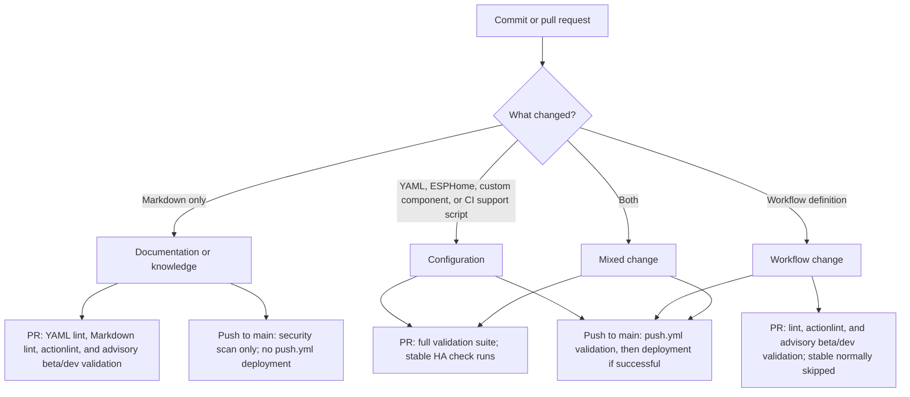
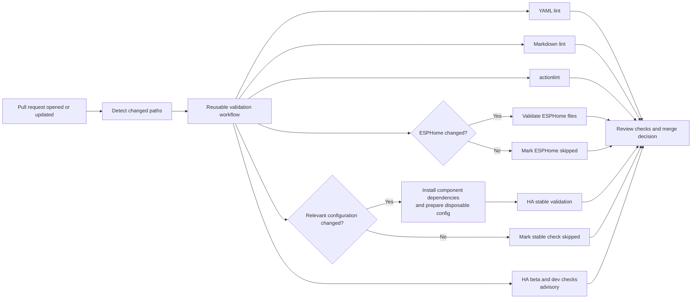
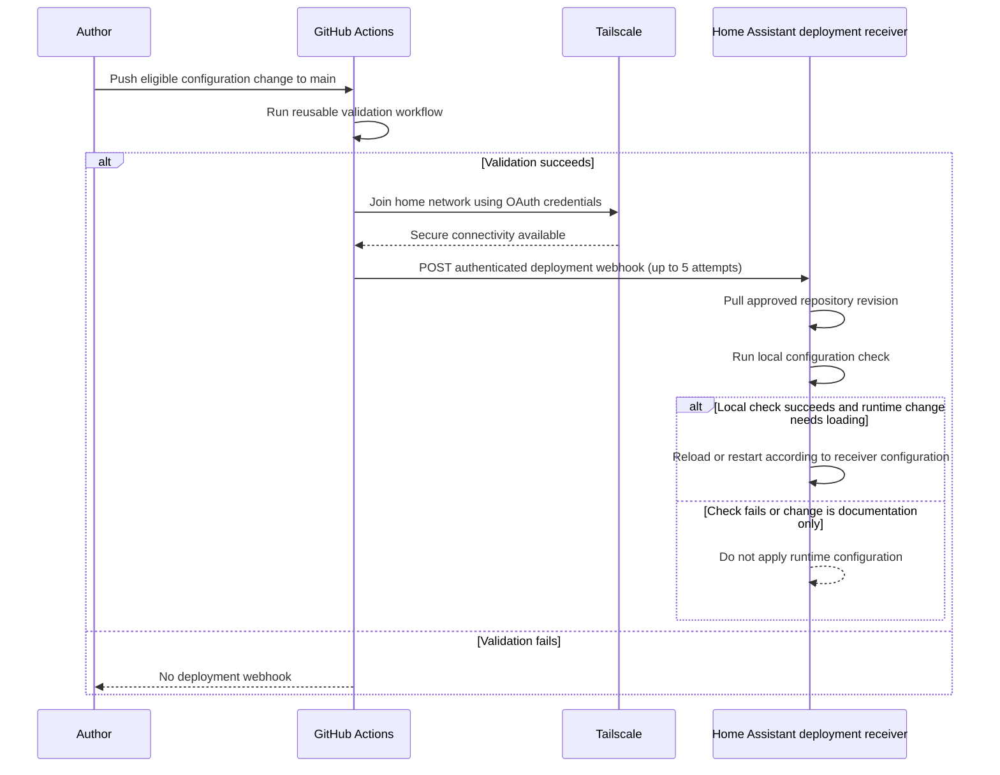
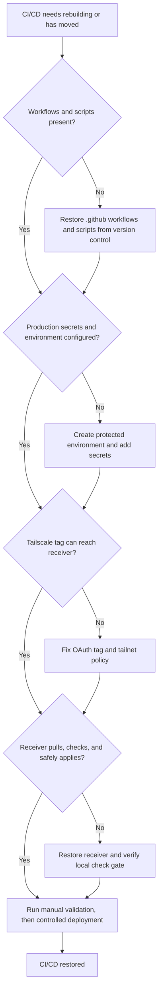

# CI/CD Pipeline Documentation

This document explains the GitHub Actions workflows for this Home Assistant configuration repository.

---

## Start Here: What Happens To A Change?

The repository distinguishes between **configuration** (YAML, ESPHome, custom components, and CI support scripts) and **documentation/knowledge** (Markdown guides, diagrams, reviews, and inventories). A pull request is the common review path for both. Deployment is considered only by `push.yml` for eligible non-Markdown pushes to `main` after validation succeeds.



### Change Behaviour

| Change type | Pull request | Push to `main` | Home Assistant deployment |
|-------------|--------------|----------------|----------------------------|
| Documentation/knowledge only (`*.md`) | `pull.yml` runs. YAML lint, Markdown lint, actionlint, and advisory beta/dev checks run; the stable Home Assistant check reports **Skipped**. | `push.yml` does not run because its path filter excludes Markdown. `security.yml` still scans the push. | No deployment webhook is sent. |
| Configuration or CI support-script change | `pull.yml` runs. Stable Home Assistant validation runs for YAML, custom-component, ESPHome, and `.github/scripts/**` changes; ESPHome validation runs when `esphome/**` changes. | `push.yml` validates the configuration. `metrics.yml` runs for its YAML/ESPHome paths; `security.yml` also runs. | After the reusable validation workflow succeeds, `push.yml` sends the deployment webhook. |
| Workflow definition (`.github/workflows/**`) | `pull.yml` runs YAML/Markdown lint, actionlint, and advisory beta/dev validation. The stable HA check is normally **Skipped** because the PR path filter does not classify workflow definitions as configuration. | `push.yml` runs because `.github/**` is included in its path filter; it runs stable validation and can deploy after success. | Yes after the push workflow's validation succeeds. Review workflow changes especially carefully. |
| Mixed configuration and documentation/knowledge change | Same as configuration change; Markdown lint also checks the documentation. | Same as configuration change. | Yes, after validation succeeds. |

> **Important:** the beta/dev Home Assistant checks are advisory. The stable Home Assistant configuration check is the production gate for eligible configuration changes. YAML lint, Markdown lint, and actionlint currently publish findings without blocking the reusable validation workflow.

## Pipeline Diagrams

### Pull Request Validation



### Configuration Delivery To Home Assistant



The workflow proves that the webhook was requested; the final pull, local check, and reload/restart are responsibilities of the Home Assistant-side receiver. Confirm those steps in its local logs after a deployment.

---

## Workflows Overview

| Workflow | Trigger | Purpose |
|----------|---------|---------|
| `push.yml` | Push to main, weekly schedule, manual | Validates config and deploys to production HA |
| `pull.yml` | Pull requests | Validates config before merge |
| `_ha-validate.yml` | Called by push/pull | Reusable validation logic (yamllint, ESPHome, HA stable/beta/dev) |
| `security.yml` | Push, PR, weekly Monday | Secret scanning (TruffleHog, Gitleaks) + Python security (Bandit) |
| `metrics.yml` | Push, weekly Sunday | Config statistics and health checks |
| `labeler.yml` | Pull requests | Auto-applies labels based on file changes |
| `stale.yml` | Daily | Marks stale issues/PRs for closure |

### External Integration Validation

The stable, beta, and dev Home Assistant checks each copy the repository into a
disposable directory, excluding any local `custom_components`, then download
the latest non-prerelease GitHub Release for every domain listed in
`.github/ci/external-integrations.json`. They build the selected Home Assistant
image with those manifest requirements and run `check_config`.

The workflow fails if an integration has no stable release, its archive does
not contain a manifest matching the declared domain, or a
dependency cannot install. The job summary records the resolved releases.
It does not validate production credentials, UI config entries, network access,
or physical devices.

## Rebuild Or Move The CI/CD Setup

Use this checklist when recreating the automation in a replacement repository, GitHub organization, Home Assistant host, or Tailscale tailnet. Do not put secret values in this repository.

1. **Create the GitHub repository and default branch.** Keep the workflows, `.github/ci/` registry, `.github/scripts/`, `secrets.yaml.sample`, and ESPHome sample secrets in version control. Manage production custom integrations through HACS. Protect `main` and require the stable Home Assistant check by its exact current name: `Home Assistant Core Stable Configuration Check`.
2. **Configure repository environments and secrets.** Create the `production` environment used by `push.yml`. Add the Tailscale OAuth client ID and secret, the deployment webhook URL, and its authentication token as GitHub Actions secrets. Use the secret names referenced in the [Required Secrets](#required-secrets) table; do not place values in YAML, Markdown, workflow logs, or commits.
3. **Authorize the GitHub runner in Tailscale.** Create an OAuth client allowed to create the workflow's configured tag (`tag:homeassistant-ci`), then grant that tag network access to the Home Assistant deployment receiver. Test from a manual workflow run before relying on automatic delivery.
4. **Create or restore the Home Assistant deployment receiver.** It must accept the authenticated POST sent by `push.yml`, pull the intended repository/revision, run a local Home Assistant configuration check, and only reload or restart when that check passes and the change needs applying. The receiver implementation is environment-specific and is not stored in this repository.
5. **Verify the validation image can load the repository.** Keep `secrets.yaml.sample` current enough for validation and `.github/ci/external-integrations.json` aligned with the production custom integrations used by YAML. Every listed upstream release must contain a manifest for its declared domain. `.github/scripts/prepare-config-for-ci.sh` modifies only the disposable CI checkout.
6. **Test all three paths.** Open a Markdown-only PR, a configuration PR, and a mixed PR. Then use **Actions → Push - Validation → Run workflow** with deployment unchecked to test validation, followed by a deliberate deployment test in the protected environment.
7. **Record environment-specific recovery details privately.** Store deployment URLs, receiver configuration, and Tailscale policy details in the appropriate secrets manager or private runbook—not in this public configuration repository.

### Recovery Decision Flow



---

## Known Issues & Limitations

### Pip Caching

**Status:** ❌ Disabled

**Why:** The custom-integration requirements are generated inside the disposable
Docker build context, so runner-level pip caching does not apply. ESPHome
dependencies are also installed dynamically.

**History:** Removed in commit `0d2395fc` (September 2024) - "Removed cached PIP to fix pipeline build errors"

**Context:** Dependencies are installed dynamically:
- ESPHome: Direct `pip install esphome`
- Custom integrations: Downloaded from the CI registry and installed in the
  disposable Home Assistant image

**Future option:** The external-integration action generates requirements in its
disposable config directory. Add an explicit Docker cache strategy only if
build times become a measured problem.

**Current Performance:** Home Assistant validation allows 30 minutes for downloading external integrations and building the disposable image; the separate ESPHome job remains capped at 15 minutes.

---

### Device Triggers in CI

**Issue:** Device triggers reference device IDs from the production Home Assistant device registry. In CI, the device registry is empty, causing validation errors:

```
ERROR: Unknown device '7da5565cc39ea45df83d982a085622b6'
```

**Solution:** Device trigger blocks are replaced with dummy time triggers during CI preparation (see `.github/scripts/prepare-config-for-ci.sh`):

```yaml
# Before (production)
triggers:
  - trigger: device
    domain: mqtt
    device_id: 7da5565cc39ea45df83d982a085622b6
    type: action
    subtype: on_press_release

# After (CI)
triggers:
  - trigger: time
    at: "00:00:00"  # Dummy trigger for CI validation
```

**Affected files:** bedroom.yaml, bedroom2.yaml, bedroom3.yaml, office.yaml

---

### External Custom Integrations

CI retains YAML integration configuration and installs the latest stable release
of each required custom integration from `.github/ci/external-integrations.json`.
It fails rather than removing an integration if an upstream release, manifest,
or Python dependency is unavailable. Device-trigger replacement is still
performed only in the disposable configuration copy.

---

## CI Scripts

### `.github/scripts/install-external-integrations.py`

Downloads the latest stable release for each registry entry, extracts the
manifest-matched integration into the disposable configuration, and generates
the requirement set installed in the corresponding Home Assistant image.

### `.github/actions/prepare-external-ha-config/action.yml`

Shared preparation action used by the stable, beta, and dev validation jobs.
It creates the disposable configuration, injects external integrations, copies
sample secrets, and runs the CI-only preparation script.

### `.github/scripts/prepare-config-for-ci.sh`

Prepares config for CI validation:
1. Creates required directories (`camera/`)
2. Retains installed external integrations for validation
3. Replaces device triggers with dummy time triggers

**Environment variables:**
- `HA_CHANNEL` - Set to `beta` or `dev` for channel-specific handling (defaults to `stable`)

---

## Deployment

### How Deployment Works (push.yml)

After successful validation on push to `main`:

1. **Connect via Tailscale** - Establishes secure connection to home network
   - Uses OAuth secrets: `TS_OAUTH_CLIENT_ID`, `TS_OAUTH_SECRET`
   - Tagged with: `tag:homeassistant-ci`

2. **POST to Webhook** - Triggers Home Assistant to pull changes
   - URL: `DEPLOYMENT_URL` (secret)
   - Auth: `PULL_KEY` (secret)
   - Retries: 5 attempts with 3s delay between

3. **Home Assistant** - Presumably pulls git repo and reloads configuration

---

## Maintenance

### Adding New Custom Components

1. Add its domain and upstream GitHub repository to `.github/ci/external-integrations.json`.
2. Confirm the latest stable release contains a matching manifest and any requirements.
3. If it uses device triggers, CI preparation already replaces those only in the disposable copy.

### Updating Home Assistant Version

1. Monitor beta/dev validation runs for compatibility warnings
2. Investigate failing custom-integration releases instead of stripping YAML configuration
3. Test with `workflow_dispatch` before merging

### Modifying Validation Logic

Both scripts (`.github/scripts/*.sh`) are called by multiple workflow jobs. Changes apply to:
- `ha-stable` validation
- `ha-future` validation (beta + dev matrix)

---

## Required Secrets

| Secret | Purpose | Used By |
|--------|---------|---------|
| `TS_OAUTH_CLIENT_ID` | Tailscale OAuth client ID | push.yml (deployment) |
| `TS_OAUTH_SECRET` | Tailscale OAuth secret | push.yml (deployment) |
| `DEPLOYMENT_URL` | Home Assistant webhook URL | push.yml (deployment) |
| `PULL_KEY` | Webhook authentication token | push.yml (deployment) |

---

## Troubleshooting

### Validation Fails with "Unknown device" Error
- Device trigger in automation → Already handled by `prepare-config-for-ci.sh`
- Check logs to confirm device trigger replacement worked

### Validation Fails with "Integration not found"
- Confirm the domain and upstream repository in `.github/ci/external-integrations.json`
- Confirm the upstream latest stable release still contains that domain's `manifest.json`

### Custom Component Dependency Install Fails
- Check the downloaded integration manifest and generated requirement set in the workflow logs
- Verify its declared PyPI package/version remains available

### Deployment Not Triggering
- Verify Tailscale connection succeeded
- Check `DEPLOYMENT_URL` and `PULL_KEY` secrets are correct
- Review Home Assistant automation logs for webhook reception

## Operating model

### Pull Request workflow
- `pull.yml` runs validation for pull requests.
- It detects relevant changes first, then calls the reusable validation workflow.
- Home Assistant stable validation is the main blocking configuration check.
- Future channel checks (`beta`, `dev`) are informational only.

### Push workflow
- `push.yml` runs on pushes to `main`, weekly schedule, and manual dispatch.
- Pushes to `main` validate first and then may deploy if validation succeeds.
- Scheduled runs are intended as future-compatibility heads-up checks.
- Manual runs allow explicit selection of HA stable validation, ESPHome validation, and deploy.

### Labeler workflow
- `labeler.yml` uses `pull_request_target` intentionally.
- Reason: fork-based PRs need base-repository permissions to apply labels.
- Constraint: this workflow must remain metadata-only.
- Do not add PR-head checkout or execution of PR code to this workflow.

### Branch protection / check naming
- Stable required check names should remain unchanged unless branch protection is updated deliberately.
- Prefer present-and-skipped jobs over conditionally absent required checks.

## Future channel validation strategy

Current behaviour:
- `ha-future` runs on PR validation and push validation.
- Its results are informational only and do not block merges.

Review questions for future changes:
- Should future-channel validation stay on every PR?
- Should it become schedule-only or manual for some change classes?
- Is the compatibility signal worth the runtime cost on routine PRs?

Default guidance:
- keep it as-is unless CI time/noise becomes a real problem
- if changed, document the trade-off explicitly

## Troubleshooting notes

### Fork PR labeler failures
- Symptom: `Resource not accessible by integration`
- Cause: fork PRs need base-repository permissions for metadata writes
- Current design: use `pull_request_target` for metadata-only labelling
- Guardrail: do not add PR-head checkout or PR-code execution to that workflow

### CI prep script effects
- Validation results may reflect CI preparation, not raw repo state
- Check `.github/scripts/prepare-config-for-ci.sh` when integrations or triggers appear to behave differently in CI

### Custom component dependency failures
- Check `.github/scripts/install-external-integrations.py`
- Review the resolved release table and generated requirement install output

### Healthy skipped checks
- Some jobs are designed to succeed with a clear "Skipped" result when work is not relevant
- Prefer present-and-skipped required checks over missing checks

## Summary style guide

When adding or editing workflow summaries:
- use a clear section heading
- state whether the result was Passed, Failed, or Skipped
- explain skipped paths plainly when they are healthy
- prefer operator-facing language over implementation detail
- include a log/run link where helpful

## Dependency pinning strategy

The workflow currently mixes explicit action versions with dynamically installed Python dependencies.

Guidance:
- pin GitHub Actions to known versions and update them deliberately
- treat dynamically installed Python dependencies as a conscious trade-off between freshness and reproducibility
- if a dependency becomes flaky or repeatedly breaks CI, prefer a more explicit/pinned approach for that path
- document the reason when intentionally avoiding caching or pinning changes

## README maintenance

This document has grown through iterative additions. When adding new sections:
- prefer extending existing sections over creating micro-sections
- keep related guidance together (e.g., all troubleshooting in one place)

## Required checks and branch protection

Current required checks (stable):
- Home Assistant Core Stable Configuration Check
- YAML lint
- Markdown lint (remark)
- actionlint (validate workflows)

Advisory checks (informational only):
- Home Assistant future channels (beta/dev)
- ESPHome validate (skipped when not relevant)

Guidance:
- do not rename required checks without updating branch protection
- prefer present-and-skipped jobs over conditionally absent checks
